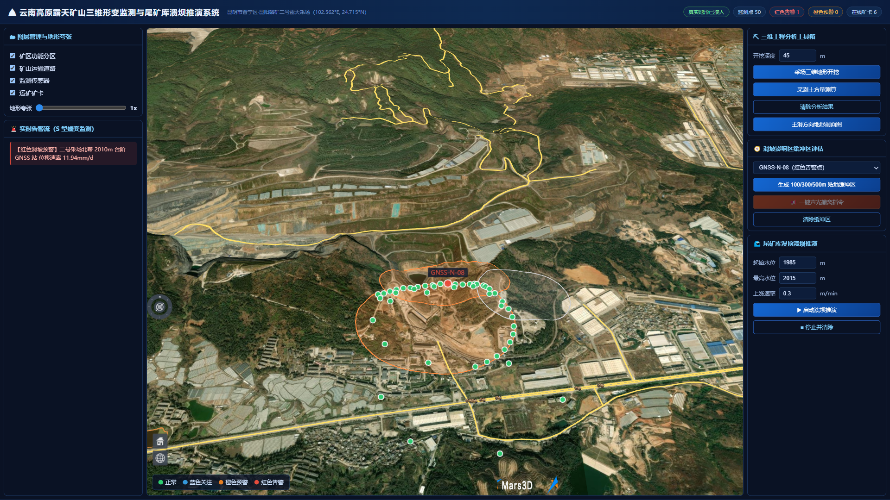
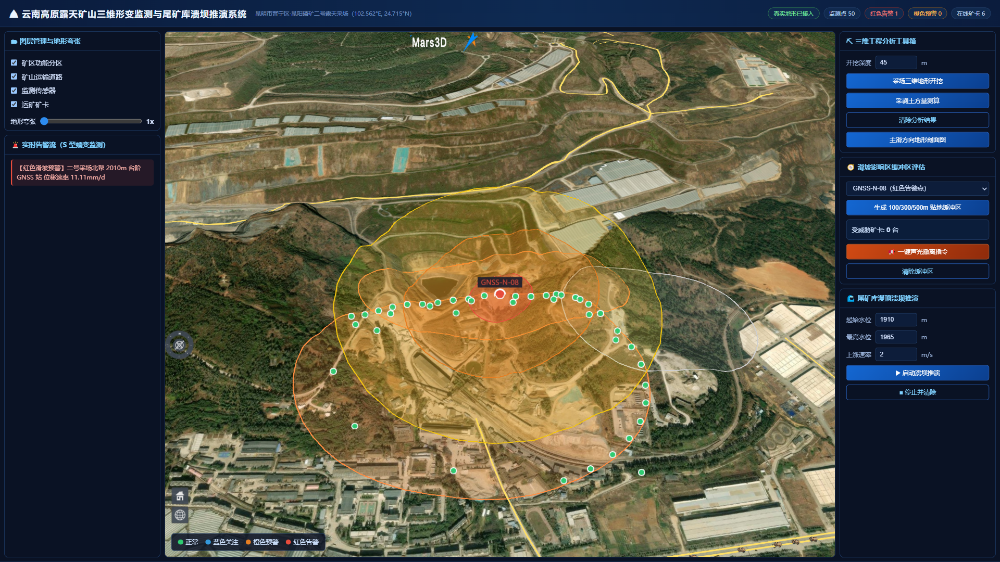
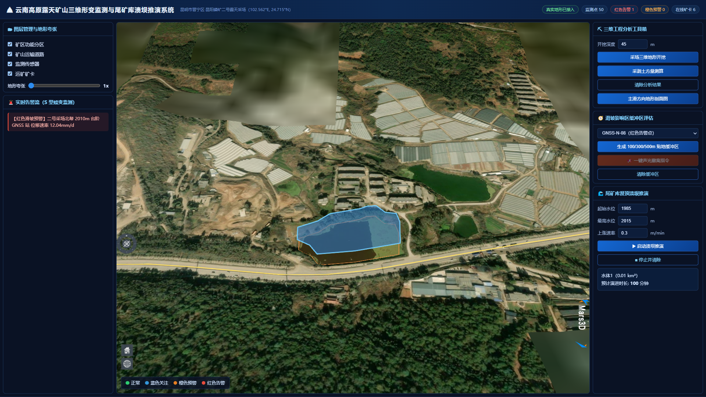
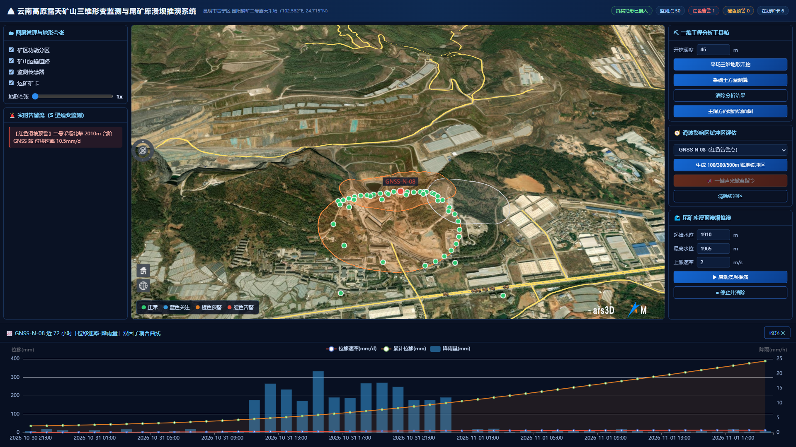
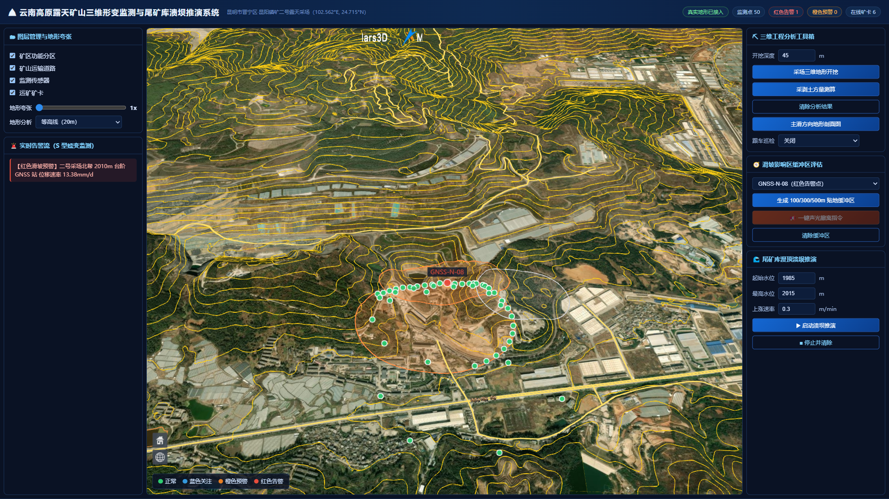
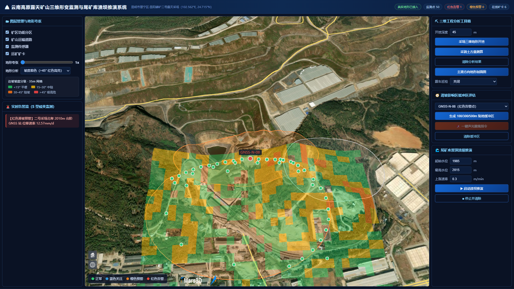

# 云南高原露天矿山高陡边坡三维形变监测与尾矿库溃坝推演系统

<div align="center">

      

**🎬 [观看演示视频（含字幕，4 分 25 秒）](docs/demo/yunnan-mine-twin-demo.mp4)**

[](docs/demo/yunnan-mine-twin-demo.mp4)

</div>

> 示范区：昆明市晋宁区 · 昆阳磷矿二号露天采场及下游尾矿库（102.562°E, 24.715°N，紧邻滇池南岸）
> Vue 3 + TypeScript + Mars3D/Cesium 三维前端 ｜ FastAPI + PostGIS 空间后端 ｜ 真实地形 + 真实影像 + 真实气象
> 一周内完成的可运行原型：核心三维链路（真实地形/影像/气象 → PostGIS 空间计算 → 三维工程分析 → 溃坝推演）全部打通并留有截图证据；二期规划见 [§9.2 工程演进路线图](#92-工程演进路线图-roadmap)。


---

## 1. 这个系统解决什么

高原露天矿山的三维数据孤岛、边坡失稳预警滞后、缺乏工程级三维空间分析工具，是智慧矿山建设的三个典型痛点。本系统用**一套可运行的三维数字孪生底座**把三者打通：

| 业务痛点 | 本系统做法 |
| --- | --- |
| 传统矿山 CAD 图纸无法呈现高陡台阶地形 | Cesium 三维球 + **Cesium 官方 `ArcGISTiledElevationTerrainProvider` 全球真实地形**（矿区实测高程 1988m，免 Key）+ ArcGIS 高清影像，直接看到真实阶梯状磷矿采坑；地形夸张 1~4 倍可调，自研 Terrarium 解码器作兜底源 |
| 雨季强降雨诱发边坡滑坡，预警滞后 | 50 个 GNSS/测斜/渗压监测点按国标阈值四级着色，**位移速率 + 降雨双因子**耦合曲线，红色告警点自动触发三维贴地缓冲区与受威胁矿卡检索 |
| 缺少三维工程分析工具 | **地形成开挖 / 采剥土方量测算 / 主滑方向剖面 / 尾矿库漫顶溃坝淹没演进** 四件套，全部基于真实 DEM 三角网计算 |

## 2. 功能总览（对应 PRD 四大模块，已实现部分）

> 下面是**已实现并有截图/实测证据**的能力；仍有差距的项见 [§9.2 工程演进路线图](#92-工程演进路线图-roadmap)。

1. **三维孪生底座**：矿区功能分区（采场 / 北帮高陡边坡 / 排土场 / 尾矿库）、矿山运输道路、50 个监测点、6 台矿卡三维模型沿盘山路实时行驶（WebSocket 1Hz 推流 + 朝向插值）；图层树独立开关、地形夸张滑块；**跟随矿卡巡检**（相机每帧绑定车头位置与航向，车后 22m 跟拍）。
2. **三维工程空间分析工具箱**：`TerrainClip` 地形开挖（带岩层侧壁贴图）、挖方/填方/投影面积测算（`mars3d.thing.Measure().volume()`）、主滑方向剖面（逐点采样地形 → ECharts 高程剖面）、**20m 等高线图层**（Cesium `ElevationContour` GPU 球面材质，实时作用于整个矿区）、**边坡坡度分级**（DEM 规则网格差分求坡度 → 四级色块贴地渲染，>40° 红色高危）。
3. **滑坡预警联动**：红色告警点 → PostGIS `ST_Buffer(geography)` 生成 **100m 核心滑塌红区 / 300m 冲击橙区 / 500m 疏散黄区** 三层贴地缓冲区，`ST_DWithin` 检索区内矿卡并分级，一键下发声光撤离指令（WebSocket 广播）。
4. **尾矿库溃坝推演**：设定起始水位 / 最高演进水位 / 上涨速率（m/min），水面按 easeOutCubic 从 1985m 抬升到 2015m 并沿山谷地形漫延（Entity + `CallbackProperty` 驱动，非 `FloodByMaterial`，原因见 §8 第 3 点）；推演中面板**实时跳字**显示当前水位 / 最大水深 / 动态淹没面积。







> 截图由本机桌面浏览器采集，采集步骤见 [`docs/screenshots/README.md`](docs/screenshots/README.md)。
> 若图片未生成，按该文档 3 分钟即可补齐（4 个带 `#shot=` 参数的 URL 会自动播放对应场景）。

## 3. 技术栈

| 层 | 选型 |
| --- | --- |
| 前端 | Vue 3.4 + TypeScript + Vite 5 + Mars3D 3.11（Cesium 1.146）+ ECharts 5 |
| 三维地形 | **首选 Cesium 官方 `ArcGISTiledElevationTerrainProvider`**（WorldElevation3D，免 Key、开放 CORS、单瓦片 0.8s）；**自研 `TerrariumTerrainProvider` 作兜底**：解码 AWS Terrain Tiles 的 terrarium PNG，`R*256+G+B/256-32768` 还原高程，**零 Key、零 Cesium ion 依赖** |
| 后端 | FastAPI + asyncpg 异步连接池 + WebSocket（矿卡轨迹 / 告警 / 撤离指令） |
| 空间数据库 | PostgreSQL 15.8 + PostGIS 3.6.2（`GEOMETRY(PointZ,4326)` 三维点、`ST_Buffer/ST_DWithin/ST_Area`） |
| 外部数据 | Open-Meteo 免 Key 气象 API（矿区实时气温/降雨/风速）、AWS Terrain Tiles、ArcGIS World Imagery |
| 部署 | 本机原生运行时（当前环境）｜ Docker Compose：PostGIS + Redis + FastAPI + Nginx（保留） |

## 4. 快速开始

```bash
# 一键启动（检测 PG 服务 → 起后端 → 起前端 → 开浏览器）
python scripts/start_all.py
# 访问 http://localhost:5174      接口文档 http://localhost:8001/docs
```

手动启动：

```bash
# 1) 数据库：Windows 服务 ynmine-pg15（PostgreSQL 15.8 + PostGIS 3.6.2，端口 5433，开机自启）
#    若需重建数据：
python scripts/fetch_osm_data.py     # 矿区矢量（OSM 抓取 / 离线 geojson / 内置参考矢量三通道）
python scripts/gen_sensor_data.py    # 50 传感器 + 3650 条 72h 时序 + 6 台矿卡

# 2) 后端（Python 3.12）
cd backend && python -m uvicorn main:app --port 8001

# 3) 前端
cd frontend && npm install && npm run dev
```

> 环境说明：本机 Python 3.13 无 `psycopg2-binary` 轮子，脚本与后端统一用 **Python 3.12**；
> PostgreSQL 数据目录必须位于**纯 ASCII 路径**（当前 `D:\ynmine-pg`），中文路径会导致 `initdb` 报
> `invalid byte sequence for encoding "UTF8"`。

## 5. 目录结构

```text
yunnan-mine-twin/
├── docs/
│   ├── PRD-设计文档.md          # 全套设计文档（PRD + 库表 + API + 部署）
│   ├── demo/                    # 演示视频（1600×900 / H.264，4 分 25 秒）
│   └── screenshots/             # README 配图 + 采集说明
├── backend/
│   ├── main.py                  # FastAPI 入口（路由挂载 + WebSocket + 启动即加载矿卡轨迹）
│   ├── core/{config,database}.py# 配置与 asyncpg 连接池
│   ├── routers/monitor.py       # 传感器/时序/分区/道路/概览
│   ├── routers/analysis.py      # 滑坡三环缓冲区、溃坝推演参数
│   ├── services/twin_engine.py  # 矿卡轨迹推进 + 传感器演化 + WS 广播
│   ├── services/weather_sync.py # Open-Meteo 实时气象
│   └── sql/init_mine.sql        # 5 张空间表
├── frontend/
│   ├── src/terrain/TerrariumTerrainProvider.ts  # 免 Key 真实地形提供器
│   ├── src/composables/useMine3DAnalysis.ts     # 开挖/土方/剖面/溃坝封装
│   ├── src/components/MapContainer.vue          # 三维底座与图层
│   └── src/views/DashboardView.vue              # 指挥大屏（四模块面板 + 图表）
├── scripts/
│   ├── fetch_osm_data.py        # OSM/离线/参考矢量三通道入库
│   ├── gen_sensor_data.py       # 传感器点位与时序生成
│   ├── start_all.py             # 一键启动
│   ├── capture_screenshots.mjs  # 自动采集 7 张功能截图
│   └── record_demo.mjs          # 自动录制演示视频（虚拟鼠标 + 字幕 + 机位脚本）
└── docker-compose.yml           # 生产编排（PostGIS+Redis+FastAPI+Nginx）
```

## 6. API 一览（前缀 `/api/v1/mine`）

| 方法 | 路径 | 说明 |
| --- | --- | --- |
| GET | `/sensors?sensor_type=&alert_only=` | 监测点三维 GeoJSON（含 Z 高程、位移速率、告警等级、告警文案） |
| GET | `/sensors/{code}/timeseries?hours=72` | 单点位移-降雨双因子时序（ECharts 数据源） |
| GET | `/zones` / `/roads` | 矿区分区 / 运输道路 GeoJSON |
| GET | `/overview` | 监测点总数、红/橙告警数、在线矿卡、分区数 |
| POST | `/spatial/landslide-impact` | 三环贴地缓冲区（100/300/500m）+ 区内受威胁矿卡分级 |
| POST | `/spatial/dam-breach` | 溃坝推演参数校验、库区面积、预计演进时长 |
| GET | `/weather` | Open-Meteo 实时气象 + 未来 24h 逐时降雨 |
| WS | `/ws/mine-twin` | 矿卡位置 1Hz 推流、传感器告警、撤离指令广播 |

## 7. 数据来源与真实性说明

| 数据 | 来源 | 真实性 |
| --- | --- | --- |
| 三维地形（DEM） | 主源 ArcGIS WorldElevation3D（官方地形服务，矿区实测高程 1988m）；兜底 AWS Terrain Tiles（terrarium 编码，源自 SRTM/GMTED） | ✅ 真实地形 |
| 卫星影像底图 | ArcGIS World Imagery（免 Key） | ✅ 真实影像 |
| 实时气温/降雨/风速 | Open-Meteo 免 Key API（矿区坐标），实测返回 18.3°C / 0mm | ✅ 真实实测 |
| 矿区运输道路 | **真实 OSM 矢量**（overpass-turbo 导出 58 条道路，ODbL 授权），入库后作为矿卡行驶轨迹依据 | ✅ 真实矢量 |
| 矿区功能分区 | 采场/排土场为参考面（OSM 该区域无 `landuse=quarry` 测绘），尾矿库/水体为 **OSM 真实面** | ⚠️ 部分参考精度 |
| 50 个监测点台账 | 参考 GB/T 51214《露天煤矿边坡监测技术规范》阈值，沿真实采坑台阶边缘布设 | ⚠️ 仿真台账 |
| 位移/渗压/降雨时序 | S 型（Logistic）加速蠕变模型 + 随机游走生成，3650 条 | ⚠️ 仿真数据 |
| 矿卡三维模型 | `mining_truck.glb`（Dump Truck，9.2k 面、含贴图，已归一化为 11.5m 车长、原点在地面） | ✅ 真实模型文件 |

> **想换成真实 OSM 矢量**：浏览器打开 <https://overpass-turbo.eu>，定位矿区，执行
> `way["landuse"="quarry"](around:2500,24.715,102.562); out body geom;`，导出 GeoJSON 存为
> `data/osm_export.geojson`，再跑 `python scripts/fetch_osm_data.py` —— 脚本会优先读离线文件入库。

## 8. 三维效果的关键实现（面试可讲的四点）

1. **免 Key 真实地形（双源）**：Cesium 默认要 ion token 才能用 World Terrain。本项目主用官方
   `ArcGISTiledElevationTerrainProvider`（WorldElevation3D，免 Key、CORS 开放）；同时自研
   `TerrariumTerrainProvider` 作兜底：实现 `requestTileGeometry / getLevelMaximumGeometricError /
   getTileDataAvailable`，用 `WebMercatorTilingScheme`（瓦片本身是 EPSG:3857，用 Geographic
   会整体错位），把 `(level,x,y)` 直接映射到 terrarium 的 `z=level`，canvas 解码 PNG 后填
   `HeightmapTerrainData`，带失败重试与瓦片缓存。**取不到瓦片时返回零高度占位数据而不是
   `undefined`**——后者会让 Cesium 渲染管线抛错并停止整帧渲染。
2. **观感调优（踩过的坑）**：① 地形必须"先椭球、探测通过再挂载"，否则地形瓦片一失败整个地表
   都不渲染，表现为"连底图都没有"；② 地形夸张与相机高度必须协同（当前 1.0 倍 + 相机 900m 俯瞰）——
   **关键教训：模型默认 `enableVerticalExaggeration=true`，会跟着地形再乘一次夸张系数，
   与"按夸张后高程摆位"叠加后模型被顶到 ~1100m 高空，表现为矿卡完全消失**；正解是模型侧
   关掉该开关、高程统一取 `globe.getHeight()`（渲染面高度）；③ 点/线/面用 `clampToGround` 贴地，
   模型不能贴地（会被未夸张的地表高度覆盖），必须逐帧按渲染面高度摆位 + 抬高 2m 避免
   z-fighting；④ 场景时钟锁定当地正午（`2026-11-01T04:00:00Z`），Cesium 默认跟随系统时间，
   夜间开场整个地球是黑的，极易被误认为"平面图"；⑤ 关闭 `showGroundAtmosphere`，低空会在
   影像上蒙一层蓝雾。
3. **贴地缓冲与淹没**：缓冲区用 `ST_Buffer(geom::geography, r)` 直接按米计算，前端
   `clampToGround: true` 贴地渲染避免穿模；溃坝演进没有用 mars3d 的 `FloodByMaterial`
   （它依赖修改版 Cesium 的内部回调 `GlobeSurfaceTileProvider._initByMars3D`，当前
   mars3d-cesium 1.146 构建里该回调缺失，`marsOptions` 恒为 undefined，一挂载就抛错），
   改为 **Entity + `CallbackProperty` 驱动 `height`**：水位按 easeOutCubic 从 1985m 抬到
   2015m，几何不重建，另配一条同步升高的 polyline 描出淹没边界。水位区间按库区实测库底
   1989m 标定——**早期把水位设成 1910~1965m，水面整个在地形以下，画面上根本看不到水**。
4. **坡度分析为什么放弃 GPU 材质、改走 DEM 差分**：Cesium 自带的 `SlopeRamp` 材质看着最省事，
   但它的着色公式调用 `czm_slope()`，该函数依赖地形瓦片携带的**顶点法线**；ArcGIS
   WorldElevation3D 只返回高程、不生成法线，结果材质能挂上、画面零变化（采样坐标全 NaN，
   不是报错而是静默失效，比报错更难查）。改为自己算：先等 `globe.tilesLoaded`，
   用 `sampleTerrain(provider, 13, pts)` **固定层级批量采样**（整片采场落在 1~2 张瓦片里，
   一次请求即回；`sampleTerrainMostDetailed` 在最高层级容易超时或拒绝批量请求），
   再按 32×24 网格（约 35m 格子）中心差分求坡度，四级色块用 `ClassificationType.TERRAIN` 贴地渲染。
   **代价与诚实边界**：35m 网格会把 15m 高的台阶平均成 20~35°，所以截图里以绿/黄/橙为主，
   >45° 红格只在真实陡立面出现——这是分辨率决定的，不是配色没生效。

## 9. 已验证结论（2026-11-02 本机实测）

- 数据库：5 张空间表，**6 个分区（采场 2 / 排土场 1 / 水体 3）** / **58 条真实 OSM 道路** / **50 个监测点** / **3650 条时序** / 6 台矿卡
- 矢量来源：`data/osm_export.geojson`（overpass-turbo 导出，ODbL），脚本自动完成"传感器解绑 → 分区重建 → 按最近分区重链（50/50）"
- 矿卡轨迹：自动选取几何距采场 < 600m 的真实道路并裁剪到 900m 半径内，实测 6 台车距采场中心 **450~585m**，全部行驶在矿区道路上（速度换算已修正为 2s/8m 步长，不再瞬移）
- 接口：7 个 REST + 1 个 WebSocket 全部实测通过；滑坡分析返回 3 环缓冲区 + 区内矿卡分级，**受威胁台数随矿卡实时位置在 0~2 台之间变化**（截图时刻恰有 1 台驶入 500m 环内），不是写死的数字
- 气象：Open-Meteo 实返 18.3°C、风速 9.8km/h、未来 24h 逐时降雨数组
- 地形：ArcGIS WorldElevation3D 采样矿区高程 **1988m**；Terrarium 兜底源解码 1887~1991m，与滇池南岸真实海拔吻合
- 前端：`vite build` 通过，dev 服务器 + `/api` `/ws` 代理验证通过；截图脚本 `scripts/capture_screenshots.mjs` 用**有头** Chromium 采集（SwiftShader 无头渲染 Cesium 会黑屏/无光照，故不采用无头）
- 地形分析：等高线（`ElevationContour`，20m 等高距）与坡度分级（32×24 网格、`sampleTerrain` 13 级采样、四级色块贴地）均已出图（截图 06 / 07）；坡度分级中 >40° 红格占比很低，原因见 §8 第 4 点
- 演示视频：`scripts/record_demo.mjs` 有头录制 → H.264 转码，产出 `docs/demo/yunnan-mine-twin-demo.mp4`；录制前对 7 个机位做地形预热（否则低空瓦片收敛不了，画面会露出未贴图的黑色地块，详见 `docs/demo/README.md`）

### 9.1 已知短板（面试/交付时如实说明）

| 短板 | 现状 | 补齐路径 |
| :--- | :--- | :--- |
| **无鉴权** | 接口全部裸奔，无 JWT / 角色权限 | 加 FastAPI + JWT（`python-jose`）+ 矿-区-人三级数据域 |
| **无高可用** | 单机 PostGIS + 单进程 FastAPI，无副本与故障转移 | 容器化 + 主备流复制 + Nginx 反代 |
| **传感器/时序为仿真** | Logistic 加速蠕变 + 随机游走生成，非真实监测数据 | 对接真实 GNSS/测斜/渗压设备 MQTT/HTTP 上报 |
| **溃坝为水位演进** | 水面 Entity 按高程区间抬升（1985→2015m），非水动力学模型 | 接 HEC-RAS / MIKE 21 计算淹没范围与到达时间 |
| **OSM 无采坑面** | 该矿区 OSM 未测绘 `landuse=quarry`，采场用参考面 | 用无人机倾斜摄影/矿区实测 CAD 替换 |
| **尾矿库是近似面** | OSM 仅有一个 0.01km² 水塘（"水体1"），非真实尾矿库边界 | 用矿区尾矿库实测边界与库容曲线替换 |

### 9.2 工程演进路线图（Roadmap）

PRD 四大模块的主体已落地（见 §2），以下是与 PRD 逐条对照后的差距清单 —— 前四条本周期已补齐，其余为二期方向：

**本周期已补齐（11-03 迭代）**

| PRD 要求 | 实现方式 | 状态 |
| :--- | :--- | :--- |
| 跟随矿卡视角巡检（模块一） | WS 每帧回调里 `setCameraView` 绑定车头位置 + 航向，避开 `camera.lookAt` 与 Mars3D 的 transform 冲突 | ✅ 已实现（截图 05 为同机位定格版） |
| 等高线图层（模块一） | `Cesium.Material.fromType('ElevationContour')` GPU 球面材质，20m 等高距实时渲染，零后端 | ✅ 已实现（截图 06） |
| 溃坝逐帧淹没统计（模块四） | 面板 200ms 轮询水面实体水位，面积按库容近似曲线（A₀=0.012 → Amax≈0.185 km²，1.6 次幂）实时跳字 | ✅ 已实现 |
| 高陡边坡**坡度分级**（模块二） | `SlopeRamp` GPU 材质实测无效果（依赖顶点法线，ArcGIS 地形源不生成）；改走 DEM 网格差分：`globe.tilesLoaded` 等待 → `sampleTerrain(13)` 批量采样 → 32×24 网格求坡度 → 四级色块 `ClassificationType.TERRAIN` 贴地渲染 | ✅ 已实现（截图 07） |

**二期方向（未实现）**

| PRD 要求 | 现状 | 演进路径 |
| :--- | :--- | :--- |
| **坡向分析**与 >45° 坡面矢量提取（模块二） | 已出坡度分级，但坡向（aspect）未着色；>45° 红色格受 DEM 分辨率限制很少触发（35m 网格把 15m 台阶平均成 20~35°） | 提高 DEM 级别至 15 级并加密到 15m 网格，或后端 PostGIS `ST_Slope/ST_Aspect` 出栅格 |
| **采矿权红线图层**（模块一） | OSM 无该要素 | 接入矿区采矿许可证矢量边界（涉密数据，需甲方提供） |
| 检索受威胁的**钻机与作业人员**（模块三） | 数据库只有 `mine_vehicles`（矿卡） | 新增 `mine_workers` / `mine_equipment` 表，复用同一套 `ST_DWithin` 检索 |

## 10. 落地性评估：能用到什么程度，差在哪

| 用途 | 是否成立 | 说明 |
| --- | --- | --- |
| WebGIS/Cesium 三维全栈能力证明 | ✅ 成立 | 真实地形 + 真实影像 + 真实气象 + PostGIS 空间计算 + 三维工程分析，全链路可复现 |
| 矿山安全监测"态势大屏 + 演练"原型 | ✅ 基本成立 | 可作汇报/演练工具，需标注传感器数据为仿真 |
| 替代矿山在用边坡监测系统 | ❌ 不成立 | 缺真实传感器接入、缺滑坡力学模型、缺等保与高可用 |
| 支撑工程级边坡稳定性判定 | ❌ 不成立 | S 型曲线为演示模型，非监测反演结果 |

**四层差距**：① 感知层——50 个点位是国标阈值下的仿真台账，真实数据在矿方与第三方监测单位手中，
接入点已收敛在 `gen_sensor_data.py` 产出的表结构（换成实测只需改数据源，接口与前端不动）；
② 模型层——溃坝是"按高程抬升水面"，不是溃口流量演进（生产应接 MIKE 21 / HEC-RAS）；
③ 底座层——单机单库，缺 MVT 瓦片服务与多用户并发；④ 配套层——无登录鉴权、无审计、无监控告警。

**下一步优先级**：P0 接 1~2 个真实监测数据源（MQTT/HTTP 推送）+ JWT 登录；P1 接 MIKE/HEC-RAS 溃坝结果做可视化；
P2 传感器数据 7×24 落库与历史回放。

## 11. 界面操作指引（5 分钟走完一遍）

| 步骤 | 操作 | 预期效果 |
| --- | --- | --- |
| 1 | 打开 `http://localhost:5174`，等右上角变绿「真实地形已接入」 | 看到真实阶梯状矿坑与运输道路，矿卡沿路行驶 |
| 2 | 左侧「地形夸张」滑块拖到 3x | 台阶起伏立刻变得立体（注意别超过 3x，会超过相机高度钻进山体） |
| 3 | 点地图上红色点（GNSS-N-08） | 底部展开 72h「位移速率-降雨」双轴耦合曲线 |
| 4 | 右侧「生成 100/300/500m 贴地缓冲区」 | 红/橙/黄三环铺开，列出区内受威胁矿卡与距离 |
| 5 | 点「一键声光撤离指令」 | 左侧告警流出现撤离广播 |
| 6 | 右侧「启动溃坝推演」 | 尾矿库棕黄色水面沿山谷漫延抬升 |
| 7 | 右侧「采场三维地形开挖」→ 矿坑内画多边形 | 地形被真实挖出垂直坑壁（可配合土方量测算读体积） |
